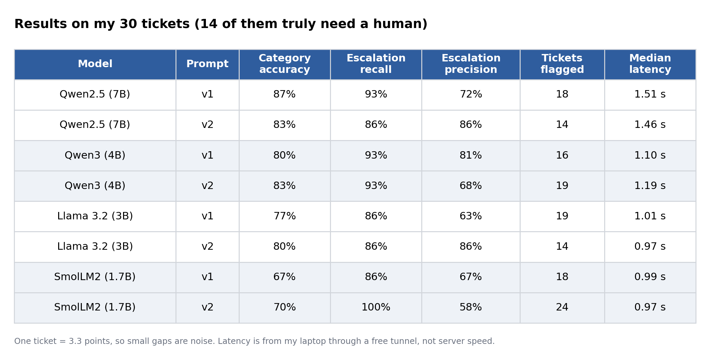
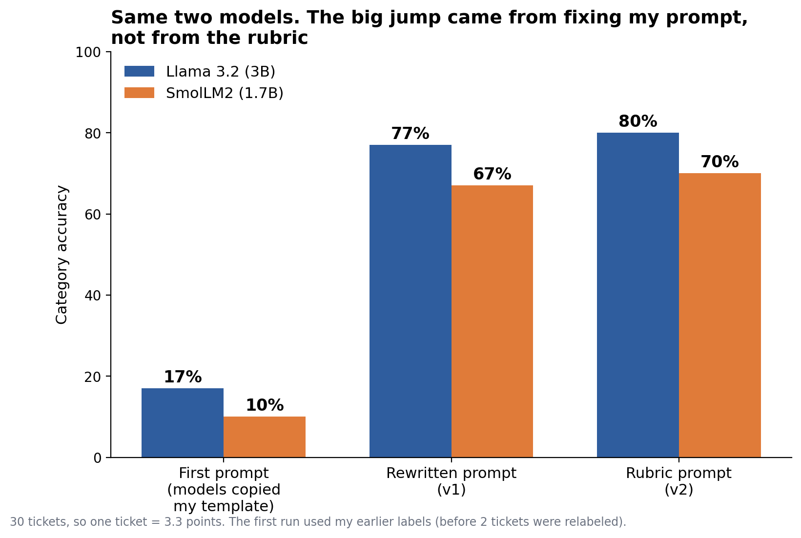
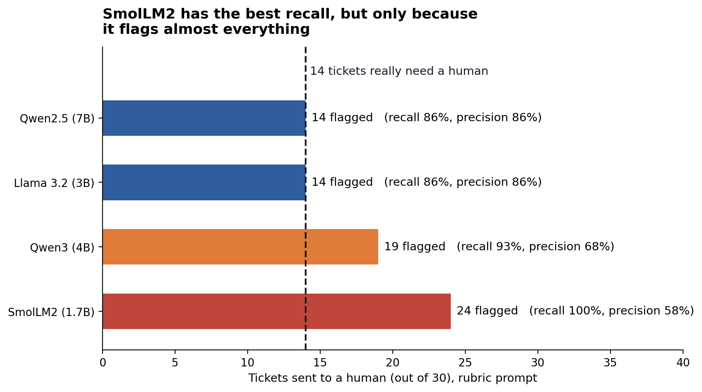
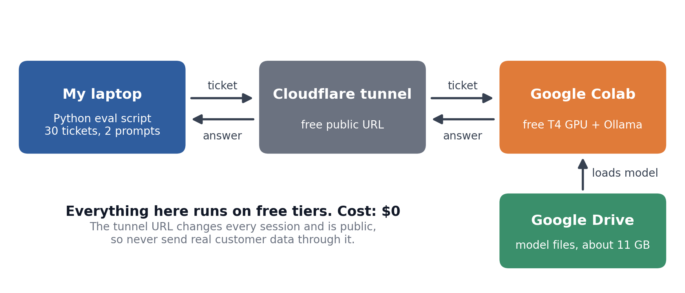

# A Leaderboard Won't Pick Your LLM. Your Own Data Will.

Code for my Medium article: **[add your Medium link here]**

I tested four small open-source models on a made-up but realistic job: reading customer support tickets and returning three things as strict JSON.

```json
{"category": "Billing", "urgency": 4, "requires_human_escalation": true}
```

- **category:** Billing, Technical Support, Account Access or Cancellation
- **urgency:** 1 to 5
- **requires_human_escalation:** true or false

Everything ran for $0, on a free Google Colab T4 GPU with models served by Ollama.

## Models tested

| Model | Size |
|---|---|
| Qwen2.5-7B-Instruct | 7B |
| Qwen3-4B-Instruct-2507 | 4B |
| Llama 3.2-3B-Instruct | 3B |
| SmolLM2-1.7B-Instruct | 1.7B |

Each model ran with two prompts: a generic one (v1) and one with a short labeling rubric (v2).

## Results



What I took from it:

- SmolLM2 (1.7B) is clearly behind the others.
- Qwen2.5-7B, Qwen3-4B and Llama 3.2-3B are too close to separate on 30 tickets.
- The biggest jump came from fixing my first prompt, not from the rubric.



- Escalation recall alone can look perfect while humans drown in false alarms.



## Limitations (please read)

- Only 30 tickets. One ticket is 3.3 percentage points, so small gaps are noise.
- The tickets and labels were generated with an LLM and reviewed by me. Five tickets are genuinely ambiguous. Two labels (TCK-004 and TCK-023) changed after I wrote the labeling rubric.
- I wrote the rubric prompt after looking at these same tickets, so the v2 numbers are probably a bit optimistic. There is no held-out test set.
- Latency was measured from my laptop through a free tunnel. It is not server speed, and it varied between runs.
- A real project needs 100 to 500 real tickets (personal details removed), labeled by people who work in support using a written rubric.

## How the setup works



## How to run it

1. Clone the repo and create a virtual environment:

   ```
   git clone https://github.com/YOUR_USERNAME/leaderboard-wont-pick-your-llm.git
   cd leaderboard-wont-pick-your-llm
   python -m venv .venv
   .venv\Scripts\activate
   pip install -r requirements.txt
   ```

   On Mac or Linux, activate with `source .venv/bin/activate`.

2. Copy `.env.example` to `.env`.

3. Start the model server. Upload `notebooks/ollama_colab_server.ipynb` to Google Colab, choose a T4 GPU, and run all cells. The notebook downloads the models into your Google Drive on the first run, starts Ollama, and prints a public URL. Put that URL in `.env` as `COLAB_BASE_URL`. The URL changes every session.

4. Run the evaluation and build the tables:

   ```
   python run_eval.py
   python analyzer.py
   ```

   Every run saves its raw answers to a `results_*.json` file, so you can look at what each model really said.

## Test your own model

All models are listed in `models.py`. To add one, add a line to the `COLAB_MODELS` list with a name and the Ollama tag, for example `("colab-my-model", "gemma3:4b")`. Any other OpenAI-compatible endpoint (a paid API, for example) works too: add an entry with its `base_url`, `api_key` and `model`.

## Files

| File | What it does |
|---|---|
| `models.py` | The list of models to test |
| `llm_client.py` | One function that calls any OpenAI-compatible endpoint and times it |
| `schema.py` | The expected JSON shape, checked with Pydantic |
| `run_eval.py` | Runs every model and prompt on every ticket and saves the answers |
| `analyzer.py` | Turns saved results into tables |
| `golden_dataset.json` | The 30 test tickets with labels |
| `huggingface_model.py` | Script I used to list candidate models |
| `notebooks/` | The Colab notebook that serves the models |
| `images/` | Charts used in the article |
| `results_*.json` | Raw model answers from my runs |

## Security

- Never commit your `.env` file. It is already in `.gitignore`.
- The Colab tunnel URL is public to anyone who has it. Treat it like a password and never send real customer data through it.

## License

MIT. See the `LICENSE` file.
